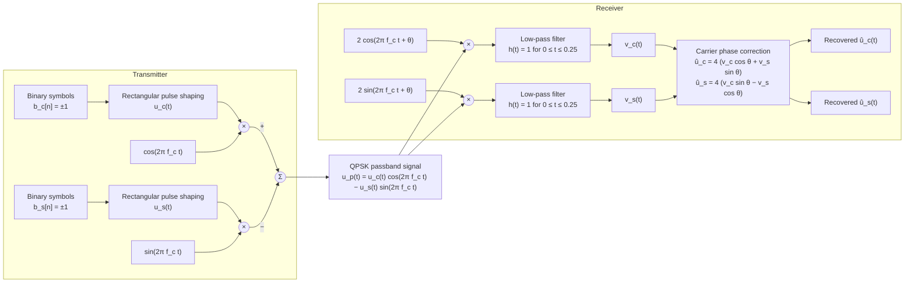
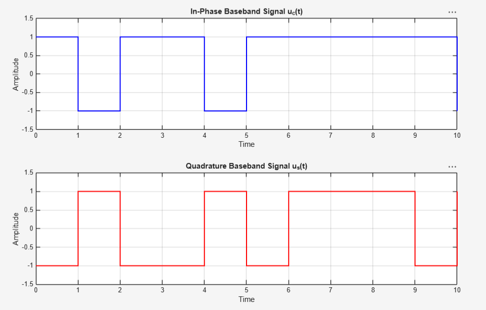
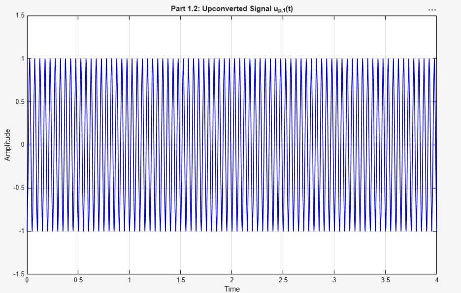
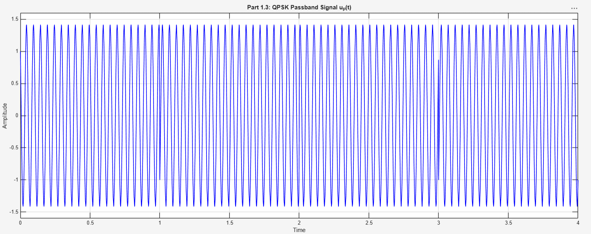
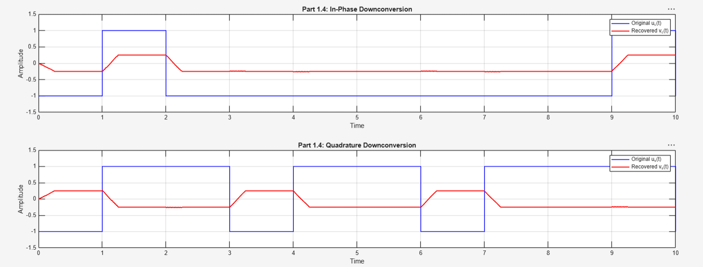
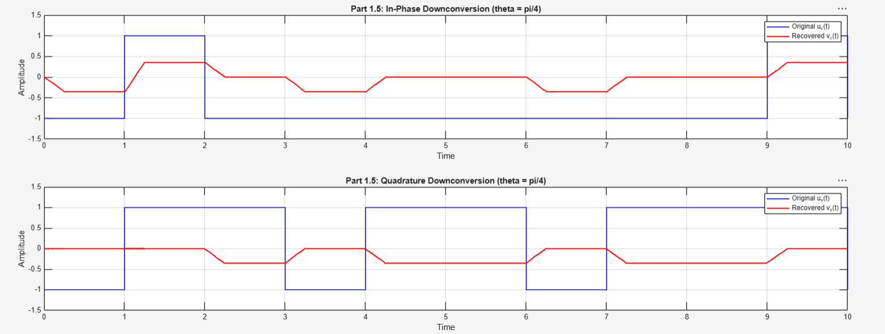
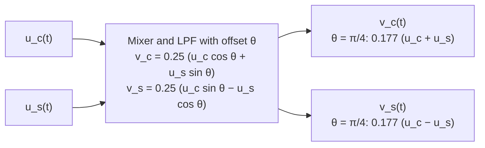
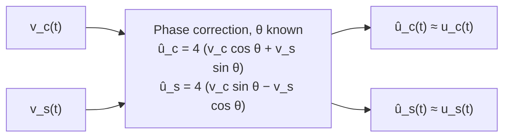
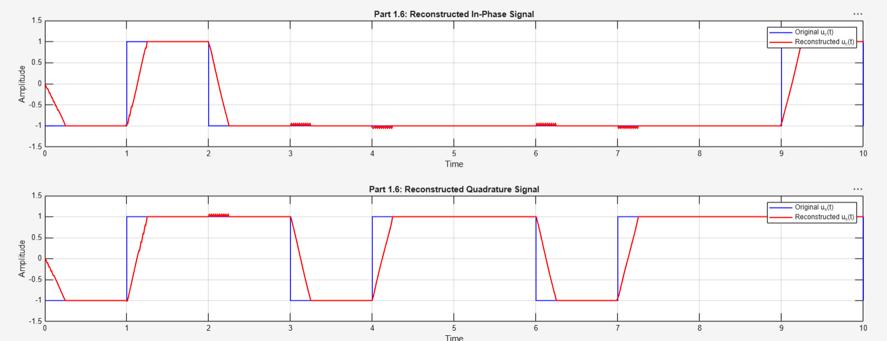

# QPSK Modulation and Carrier Phase Recovery

MATLAB simulation of a quadrature phase shift keying (QPSK) transmitter and coherent receiver, with a study of what happens to the recovered in-phase (I) and quadrature (Q) components when the receiver carrier is misaligned in phase, and how a known phase offset is undone.

## 1. Project Overview

The project builds a complete passband link in software. Two independent binary symbol streams are shaped into rectangular baseband waveforms, placed on cosine and sine carriers, and summed into a single QPSK passband signal. The receiver mixes that signal back down with a local carrier that may carry a phase offset θ, low-pass filters the products, and then applies a linear correction to separate the I and Q components again.

Three receiver conditions are investigated:

- θ = 0, the ideal coherent case.
- θ = π/4, where the I and Q components leak into each other.
- θ = π/4 with correction, where the offset is assumed known and removed algebraically.

All results are simulations. Time is normalized so that one unit equals one symbol period, and the carrier frequency is expressed in cycles per symbol. There is no channel noise in this model; the only impairments are the carrier phase offset and the non-ideal low-pass filter.

## 2. Objectives

- Generate in-phase (I) and quadrature (Q) binary baseband signals from independent ±1 symbol streams.
- Implement carrier modulation and passband signal generation.
- Simulate BPSK and QPSK waveforms and confirm their amplitude and phase behavior.
- Implement receiver downconversion with I and Q mixers followed by low-pass filtering.
- Analyze the effect of a carrier phase mismatch between transmitter and receiver.
- Reconstruct the original baseband signals from the filtered outputs using phase correction.
- Assess whether the transmitted bits can be read from the sign of each recovered component.

## 3. System Architecture

The block diagram below follows the sign conventions used in the MATLAB scripts exactly: the Q branch is subtracted at the transmitter, both receiver mixers carry a gain of 2 and the same offset θ, and the correction stage uses the matrix derived in Section 5.6.



Simulation parameters shared by the scripts:

| Parameter | Value | Notes |
|-----------|-------|-------|
| Symbols per stream, N | 100 | Independent for I and Q |
| Symbol alphabet | {−1, +1} | Generated with `randi` |
| Symbol period | 1 (normalized) | Time axis is in symbol periods |
| Samples per symbol | 100 (baseband plot), 1000 (all passband work) | 1000 gives 50 samples per carrier cycle |
| Carrier frequency, f_c | 20 cycles per symbol | Carrier is cos(40πt) |
| Receiver mixer gain | 2 | Applied to both I and Q branches |
| Low-pass filter | Rectangular, length 0.25 symbol periods | Implemented as a 250-tap FIR with taps equal to the sample spacing |
| Phase offset θ | 0 and π/4 | Receiver carrier only |
| Random seed | `rng(1)` in the three receiver scripts | Same symbol pattern across Sections 5.4 to 5.6 |

## 4. MATLAB Implementation

Each script is self-contained. It clears the workspace, generates its own symbol streams and time vector, runs one stage of the system, and opens one figure. There are no shared functions or data files.

| Script | Function in the system | Output |
|--------|------------------------|--------|
| `Matlab_Scripts/Part1_1.m` | Generates two independent ±1 symbol streams and expands each into a rectangular baseband waveform with `repelem`. Uses 100 samples per symbol. | I and Q baseband waveforms over 10 symbols |
| `Matlab_Scripts/Part1_2.m` | Regenerates the baseband signals at 1000 samples per symbol and multiplies u_c(t) by a cosine carrier at f_c = 20. | BPSK passband waveform over 4 symbols |
| `Matlab_Scripts/part1_3.m` | Adds the quadrature branch: multiplies u_s(t) by a sine carrier and subtracts it from the BPSK signal. | QPSK passband waveform over 4 symbols |
| `Matlab_Scripts/Part1_4.m` | Full transmit chain plus coherent receiver with θ = 0. Mixes with 2cos and 2sin, filters both branches with the rectangular low-pass filter using `filter`. | Original and recovered I and Q over 10 symbols |
| `Matlab_Scripts/Part1_5.m` | Identical receiver with θ = π/4 applied to both local carriers. | Original and recovered I and Q showing I/Q mixing |
| `Matlab_Scripts/Part1_6.m` | Receiver with θ = π/4 followed by the phase correction stage that rotates the filtered outputs back and restores the amplitude. | Original and reconstructed I and Q over 10 symbols |

Implementation details worth noting:

- Baseband generation is a hard expansion of each symbol into `sps` identical samples, which produces an exact rectangular pulse p(t) of unit duration.
- The low-pass filter is built as `h = ones(1, L) * dt` with `L = 0.25 * sps`. Scaling the taps by the sample spacing makes the discrete convolution approximate the continuous-time integral, so the filter has a DC gain of 0.25 rather than 250.
- The receiver scripts regenerate the transmitter internally rather than loading a saved waveform, which is why `rng(1)` is set to keep the symbol pattern consistent between the three receiver figures.

## 5. Simulation Results

### 5.1 Baseband Signal Generation

Two independent binary sequences b_c[n] and b_s[n], each taking values in {−1, +1}, are mapped to rectangular pulses of one symbol period:

$$
u_c(t) = \sum_{n} b_c[n]\, p(t - n), \qquad u_s(t) = \sum_{n} b_s[n]\, p(t - n), \qquad p(t) = \begin{cases} 1 & 0 \le t < 1 \\ 0 & \text{otherwise} \end{cases}
$$



The in-phase and quadrature streams change sign independently at integer symbol boundaries, and the amplitudes are exactly ±1. The I and Q panels are also available individually as [baseband_i_signal.png](Images/baseband_i_signal.png) and [baseband_q_signal.png](Images/baseband_q_signal.png).

Engineering significance: these two waveforms are the information the receiver must recover. Because they are independent, the receiver has to separate them cleanly; any leakage of one into the other is a direct source of decision errors.

### 5.2 BPSK Modulation

Multiplying only the in-phase waveform by a cosine carrier yields a binary phase shift keyed (BPSK) signal:

$$
u_{p,1}(t) = u_c(t)\cos(2\pi f_c t) = u_c(t)\cos(40\pi t), \qquad f_c = 20
$$



The waveform has a constant envelope of amplitude 1 and 20 carrier cycles per symbol. A sign change in u_c(t) inverts the carrier, so the data is carried entirely in the carrier phase, which flips by 180 degrees at the boundaries where consecutive symbols differ.

Engineering significance: the sampling rate had to be raised from 100 to 1000 samples per symbol for this plot. With 20 cycles per symbol, 1000 samples per symbol gives 50 samples per carrier cycle, enough to draw the carrier faithfully. The baseband rate of 100 samples per symbol would give only 5 samples per cycle.

### 5.3 QPSK Modulation

Adding the quadrature stream on a sine carrier, with the sign convention used throughout the scripts, produces the QPSK passband signal:

$$
u_p(t) = u_c(t)\cos(2\pi f_c t) - u_s(t)\sin(2\pi f_c t)
$$



Because u_c and u_s are each ±1, the signal can be rewritten as $\sqrt{2}\cos(2\pi f_c t + \phi)$ with φ taking one of four values, π/4, 3π/4, 5π/4, or 7π/4, depending on the symbol pair. The simulated peak amplitude is approximately 1.414, matching √2, and the carrier phase jumps at symbol boundaries where the symbol pair changes. In the captured realization a phase discontinuity is visible at t = 3.

Engineering significance: QPSK carries two independent bits per symbol in the same bandwidth that BPSK uses for one. The cost is that the receiver must resolve carrier phase accurately, which Sections 5.5 and 5.6 examine.

### 5.4 QPSK Demodulation Without Carrier Phase Offset

The receiver forms two mixer products and passes each through a crude low-pass filter with a rectangular impulse response:

$$
v_c(t) = \big[\,2u_p(t)\cos(2\pi f_c t + \theta)\,\big] * h(t), \qquad
v_s(t) = \big[\,2u_p(t)\sin(2\pi f_c t + \theta)\,\big] * h(t), \qquad
h(t) = \begin{cases} 1 & 0 \le t \le 0.25 \\ 0 & \text{otherwise} \end{cases}
$$

Expanding the products and discarding the terms at twice the carrier frequency, which the filter suppresses, gives the general result:

$$
v_c(t) \approx 0.25\,\big[u_c(t)\cos\theta + u_s(t)\sin\theta\big], \qquad
v_s(t) \approx 0.25\,\big[u_c(t)\sin\theta - u_s(t)\cos\theta\big]
$$

The factor 0.25 is the DC gain of the rectangular filter (unit height over 0.25 symbol periods). With θ = 0 this reduces to $v_c \approx 0.25\,u_c$ and $v_s \approx -0.25\,u_s$.



Observed behavior:

- v_c(t) follows the sign pattern of u_c(t) exactly, at a reduced level of ±0.25.
- v_s(t) has the opposite polarity of u_s(t), also at ±0.25. The inversion comes from the transmitter subtracting the sine branch while the receiver Q mixer uses +sin; the mixer gain of 2 does not change the sign.
- Every symbol transition becomes a linear ramp 0.25 symbol periods long, which is the length of the filter's impulse response. A small ripple at the double carrier frequency is visible near the transitions.

Engineering significance: with a phase-aligned carrier, the bits can be read directly from the sign of each recovered branch, with the Q decision inverted. The filter sets both the amplitude scaling and the transition shape, so any decision stage has to be calibrated to it.

### 5.5 Carrier Phase Uncertainty

With θ = π/4, cos θ = sin θ = 1/√2 and the general expressions become:

$$
v_c(t) \approx \frac{0.25}{\sqrt{2}}\,\big[u_c(t) + u_s(t)\big], \qquad
v_s(t) \approx \frac{0.25}{\sqrt{2}}\,\big[u_c(t) - u_s(t)\big]
$$

Each recovered branch is now a sum or difference of both transmitted streams. Since u_c and u_s are each ±1, each branch takes only three values: approximately +0.354, 0, or −0.354.



Observed behavior:

- v_c(t) is ±0.354 only when the two transmitted symbols agree, and 0 when they differ.
- v_s(t) is ±0.354 only when the two transmitted symbols differ, and 0 when they agree.
- Whenever a branch sits at 0, its sign carries no information, so the transmitted bits cannot be read from either recovered signal on its own.

The mixing can be written as a scaled 2×2 linear map from the transmitted pair to the recovered pair:



Engineering significance: a 45 degree carrier error is enough to collapse the I/Q separation completely. Real receivers never have a perfectly aligned carrier, which is why carrier phase estimation and correction are mandatory parts of any coherent QPSK receiver.

### 5.6 Carrier Phase Correction

Writing the filtered outputs in matrix form shows how to undo the offset when θ is known:

$$
\begin{bmatrix} v_c \\ v_s \end{bmatrix} \approx 0.25
\begin{bmatrix} \cos\theta & \sin\theta \\ \sin\theta & -\cos\theta \end{bmatrix}
\begin{bmatrix} u_c \\ u_s \end{bmatrix}
$$

The 2×2 matrix is symmetric and orthogonal, and it is its own inverse. Multiplying by the same matrix and by 4 to cancel the filter gain therefore recovers the original waveforms:

$$
\hat{u}_c = 4\,\big(v_c\cos\theta + v_s\sin\theta\big), \qquad
\hat{u}_s = 4\,\big(v_c\sin\theta - v_s\cos\theta\big)
$$

This is exactly what `Part1_6.m` computes, with θ = π/4.





Observed behavior:

- Both reconstructed signals sit at approximately ±1 and follow the original symbol patterns with the correct polarity, including the Q branch, because the correction matrix absorbs the sign inversion seen in Section 5.4.
- Each transition is a 0.25 symbol period ramp, inherited from the low-pass filter, and small oscillations appear just after some transitions. The reconstruction also starts from 0 at t = 0 while the filter fills.
- The transmitted bits can be read from the sign of each reconstructed branch over the flat portion of every symbol.

Engineering significance: once the carrier phase is known, correction is a single real 2×2 rotation and gain, applied after filtering, with no need to re-mix the passband signal. The residual errors are entirely due to the non-ideal filter and the fact that rectangular pulses are not bandlimited, not due to the phase correction itself.

## 6. Results Summary

| Simulation | Script | Receiver θ | Recovered levels | Polarity relative to original | Bits readable from sign? |
|------------|--------|-----------|------------------|-------------------------------|--------------------------|
| Baseband I/Q | `Part1_1.m` | n/a | ±1 | n/a | Yes (source data) |
| BPSK passband | `Part1_2.m` | n/a | Envelope 1, 20 cycles per symbol | n/a | Via carrier phase |
| QPSK passband | `part1_3.m` | n/a | Envelope √2 ≈ 1.414 | n/a | Via one of four carrier phases |
| Demodulation, aligned carrier | `Part1_4.m` | 0 | ±0.25 on each branch | I matches, Q inverted | Yes, with Q decision inverted |
| Demodulation, phase offset | `Part1_5.m` | π/4 | +0.354, 0, −0.354 on each branch | I and Q mixed | No, zero-valued intervals are ambiguous |
| Phase corrected | `Part1_6.m` | π/4, corrected | ±1 on each branch | Both match | Yes |

Comparison of the two receiver conditions before correction:

| Property | θ = 0 | θ = π/4 |
|----------|-------|---------|
| v_c depends on | u_c only | u_c and u_s equally |
| v_s depends on | u_s only | u_c and u_s equally |
| Number of distinct levels per branch | 2 | 3 |
| Peak level | 0.25 | 0.354 |
| I/Q separation | Complete | None |
| Correction needed | Gain of 4 and Q sign flip | Gain of 4 and 2×2 rotation |

## 7. How to Run

1. Open MATLAB and set the current folder to `Project_01/Matlab_Scripts`, or add that folder to the MATLAB path.
2. Run any script by typing its name in the Command Window, for example:

```matlab
Part1_1
```

The available scripts are `Part1_1`, `Part1_2`, `part1_3`, `Part1_4`, `Part1_5`, and `Part1_6`. Each one opens a single figure.

Notes on execution:

- There is no required order and no dependency between scripts. Each one regenerates everything it needs.
- Every script begins with `clear; clc; close all;`, so running a script closes the figures from the previous one. Run them one at a time if you want to compare figures side by side, or save each figure before moving on.
- `Part1_4.m`, `Part1_5.m`, and `Part1_6.m` call `rng(1)`, so they produce the same symbol sequence and identical figures on every run. This is what allows the three receiver figures to be compared directly.
- `Part1_1.m`, `Part1_2.m`, and `part1_3.m` do not seed the random generator, so the symbol pattern changes on each run. The figures in this README show one realization of each.
- Only core MATLAB functions are used (`randi`, `repelem`, `filter`, `stairs`, `plot`). No toolboxes are required.

## 8. Key Engineering Takeaways

- QPSK doubles the bit rate of BPSK in the same bandwidth by placing independent data on orthogonal cosine and sine carriers, which the simulated √2 envelope and four-phase structure confirm.
- Coherent downconversion works only to the extent that the receiver carrier phase matches the transmitter. A 45 degree offset mixes the I and Q streams so thoroughly that each branch becomes a sum or difference of both symbols, with zero-valued intervals that carry no sign information.
- The I/Q mixing caused by a phase offset is a linear rotation. When θ is known, undoing it is a 2×2 matrix multiply on the filtered outputs, with a gain to compensate the filter, and it restores both polarity and amplitude.
- Sign conventions matter end to end. The same receiver that recovers I with the correct polarity recovers Q inverted, because of how the transmitter combines the sine branch and how the receiver mixes it. The correction matrix in this project accounts for that automatically.
- A crude rectangular low-pass filter is sufficient to reject the double-frequency mixer terms, but it imposes its own signature: a DC gain of 0.25, a transition ramp equal to its length, a startup transient, and ripple at symbol boundaries. Decision timing has to avoid the ramps.
- Rectangular pulses are not bandlimited, so the recovered waveforms are approximations even without noise. The filter choice determines how good that approximation is.

## 9. Tools

- MATLAB (core functions only, no additional toolboxes)

## 10. Development Period

Fall 2026
